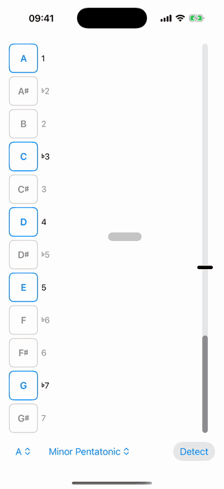

# Scale Check

An iPhone app for practicing scales on guitar. Pick a root and a scale, play,
and the screen flashes red the moment you hit a note outside it.

## Features

- **Scale column.** All twelve notes run down the left side from the root,
  with the scale's notes outlined in blue and each note's scale degree
  (1, ♭3, 4, 5, ♭7, …) beside it. The notes you're playing are highlighted.
- **Wrong-note flash.** A note outside the scale turns the screen red; an
  in-scale note clears it at once.
- **Chords.** Several notes can ring at once; the screen flashes if any of
  them is out of the scale. The middle of the screen shows the loudest note
  and its octave.
- **Detect.** Don't know what key a song is in? Tap Detect and play along.
  A bar beside each note shows how long it has sounded; once a note has
  enough of the time (5%, at least 0.15 s) it fills in, so a stray
  resonance or fluffed note doesn't throw the result. The list narrows to
  the scales that fit the filled notes. Tap one to pick it, or keep playing
  until only one note set is left and it's picked for you. Tap a note to
  fix one that was misheard.
- **Mic threshold.** The bar on the right shows the input level. Drag the
  handle to set how loud a sound must be to count, above your room's noise
  but below your playing.

Scales: major/minor pentatonic, blues, the seven modes, harmonic and melodic
major/minor, and the four triads.

## How it hears

Each ~85 ms window of audio (a new one every ~21 ms) is turned into a
spectrum and flattened, so a low note's many quiet overtones count as much as
one loud high peak. Every candidate note from a 7-string's low B up to the
24th fret is scored by the spectrum peaks at its harmonics. The best one is
taken, its harmonics are removed from the spectrum, and the search repeats
until what's left is under 65% of the loudest note. That threshold is high on
purpose: distortion adds intermodulation tones that look like quieter notes.

A note must be found in 3 windows in a row to count, and a wrong note in 5
before it flashes, which filters out the pick attack and brief artifacts.
See `ScaleCheck/Polyphony.swift`.

## Building

Open `ScaleCheck.xcodeproj` in Xcode and run it on an iPhone with iOS 17 or
later. The app needs microphone access.

The app icon is drawn by `tools/make-icon.swift`:

    swift tools/make-icon.swift ScaleCheck/Assets.xcassets/AppIcon.appiconset/AppIcon.png

The demo above is scripted rather than recorded from a mic: `-demo` (debug
builds only) plays `ScaleCheck/Demo.swift` through the listener. To redo it
after a UI change, boot an iPhone simulator and run:

    tools/record-demo.sh
